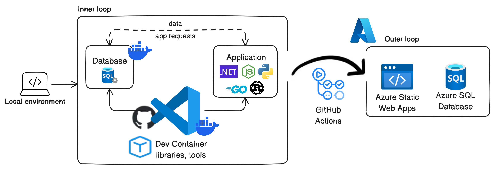

# Azure SQL Database Dev Container templates

Dev Container templates for building apps on Azure SQL Database. Each template gives you an app container for your language, a local Azure SQL Database developer container, and a sample database defined in a SQL Database project that targets Azure SQL Database.



## Templates

| Template id | Language | App container base | `imageVariant` options |
|---|---|---|---|
| [`dotnet`](src/dotnet) | .NET | Ubuntu 24.04 (noble) | `10.0-noble` (default), `8.0-noble` |
| [`dotnet-aspire`](src/dotnet-aspire) | .NET with Aspire | Ubuntu 24.04 (noble) | `10.0-noble` |
| [`python`](src/python) | Python, with the `mssql-python` driver | Debian 13 (trixie) | `3.14-trixie` (default), `3.13-trixie` |
| [`javascript-node`](src/javascript-node) | Node.js, with the `mssql` package | Debian 13 (trixie) | `24-trixie` (default), `22-trixie` |

.NET 8 support ends on 2026-11-10. After that date, use `10.0-noble`.

Every template includes:

- The Azure SQL Database developer container from `mcr.microsoft.com/mssql/azure-sql-db-server:latest`.
- The `Library` sample database. It's built from the SQL Database project and published with SqlPackage when the container is created.
- The .NET SDK (.NET 10; the `dotnet` template also offers .NET 8), SqlPackage, `sqlcmd` (go-sqlcmd), Azure CLI with Bicep, and the Azure Developer CLI.
- VS Code tasks to verify the data and to build and publish the SQL Database project.

## How Azure SQL Database compatibility works

The local container runs the Azure SQL Database engine, not SQL Server Developer edition. The SQL Database project also targets Azure SQL Database (`SqlAzureV12DatabaseSchemaProvider`), so unsupported schema features fail the project build. After a successful build, the startup script provisions `Library` through `master`, then publishes directly to `Library`. The LocalDev profile and language samples connect to `Library`; application queries do not switch databases with `USE`.

The container is for development, testing, and demos, not production. The preview has known restriction-enforcement gaps and defaults that can differ from Azure SQL Database in Azure. Validate against the cloud before shipping, and review the [upstream requirements and limitations](https://github.com/microsoft/azure-sql-database-container).

## Use a template

**VS Code.** Install Docker and the [Dev Containers extension](https://code.visualstudio.com/docs/devcontainers/containers). Open your project folder, press <kbd>F1</kbd>, and run **Dev Containers: Add Dev Container Configuration Files...**. Select **Show All Definitions...**, type **Azure SQL**, and pick a template. Then run **Dev Containers: Reopen in Container**.

**GitHub Codespaces.** In a codespace, run **Codespaces: Add Dev Container Configuration Files...** and follow the same steps. Then run **Codespaces: Rebuild Container**.

**Dev Container CLI.**

```bash
devcontainer templates apply -t ghcr.io/microsoft/azuresql-devcontainers/<id>
devcontainer up --workspace-folder .
```

Each template's README covers the tasks, the sample database, and the password setting.

## Apple Silicon

Both containers support native `linux/amd64` and `linux/arm64`, including Apple Silicon. Compose selects the host architecture; the database service no longer forces amd64 emulation. Use Linux containers and allocate at least 4 GB of memory and 2 CPUs to the runtime. Each database service is limited to 2 GB and 2 CPUs. See the [upstream prerequisites](https://github.com/microsoft/azure-sql-database-container/blob/main/docs/prerequisites.md).

## Testing

Every pull request that changes a template runs that template's full smoke test on amd64 and arm64 in GitHub Actions. The test always builds and starts both the app and Azure SQL database containers, then checks the Azure SQL engine identity, sample database, and language sample. There is no database-free mode.

To run the same checks on your machine, use `test/gauntlet.sh`. It needs Docker and the Dev Container CLI.

For startup sequencing and failure-handling checks without Docker, run `bash test/test-utils/check-startup.sh`. These use command doubles, not a running engine. `test/test-utils/check-tags.sh` checks that the configured app and database image tags expose both native architectures.

## Learn more

- [What are SQL database projects?](https://learn.microsoft.com/sql/tools/sql-database-projects/sql-database-projects?view=sql-server-ver17)
- [Target platform for SQL database projects](https://learn.microsoft.com/sql/tools/sql-database-projects/concepts/target-platform?view=sql-server-ver17)
- [Azure SQL Database container](https://github.com/microsoft/azure-sql-database-container)
- [Dev Container templates specification](https://containers.dev/implementors/templates/)

## Contributing and feedback

Report problems in [GitHub issues](https://github.com/microsoft/azuresql-devcontainers/issues). Contributions to the [templates](src) are welcome.

## License

Copyright (c) Microsoft Corporation. Licensed under the MIT License. See [LICENSE](LICENSE).
