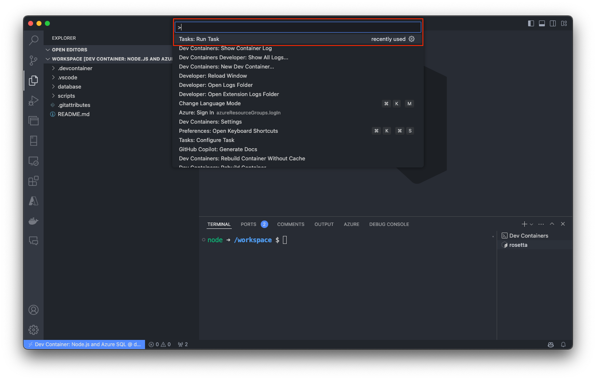
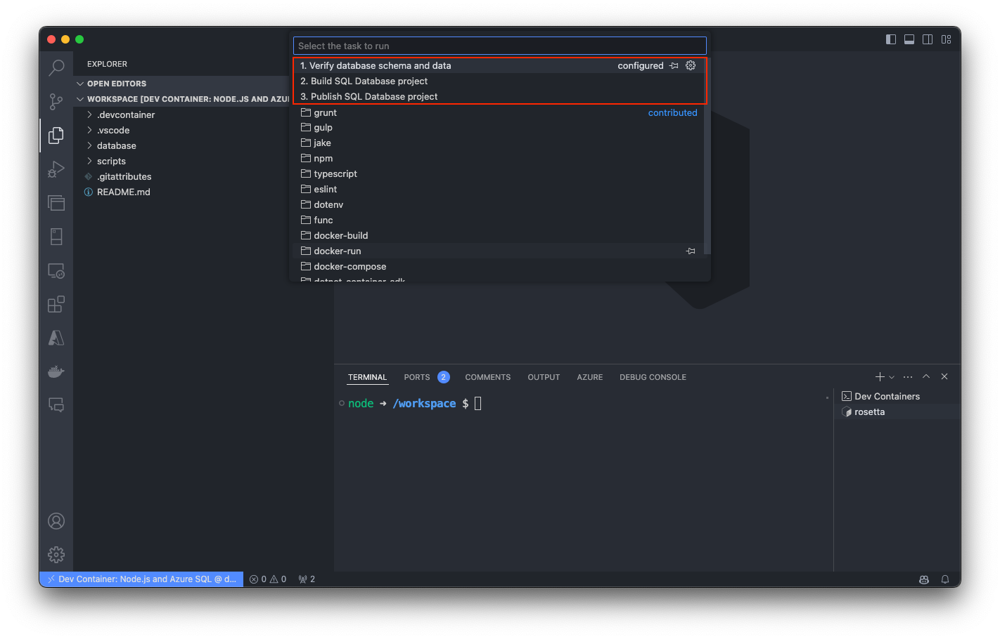
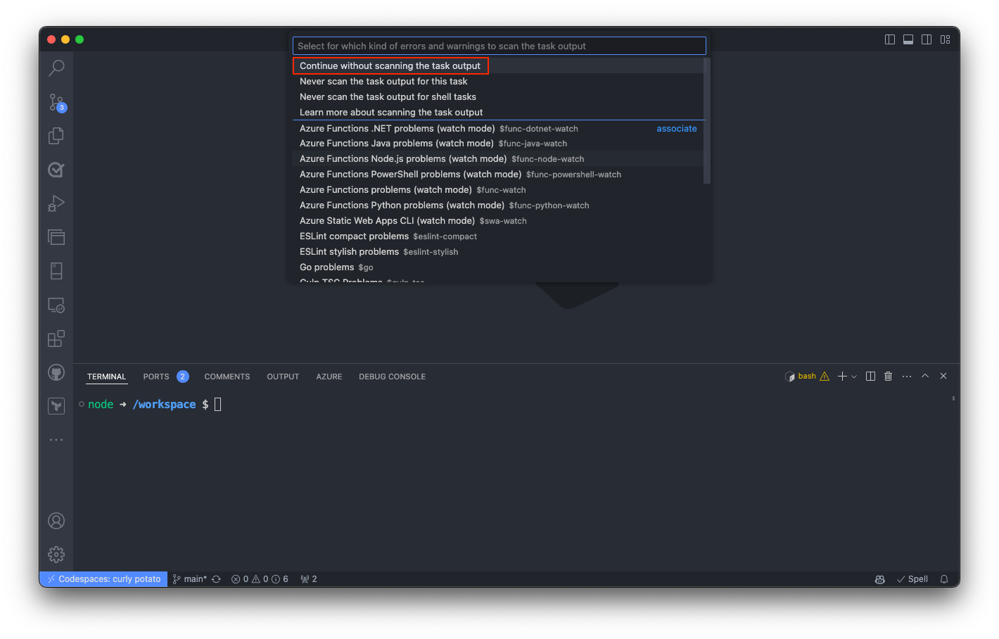
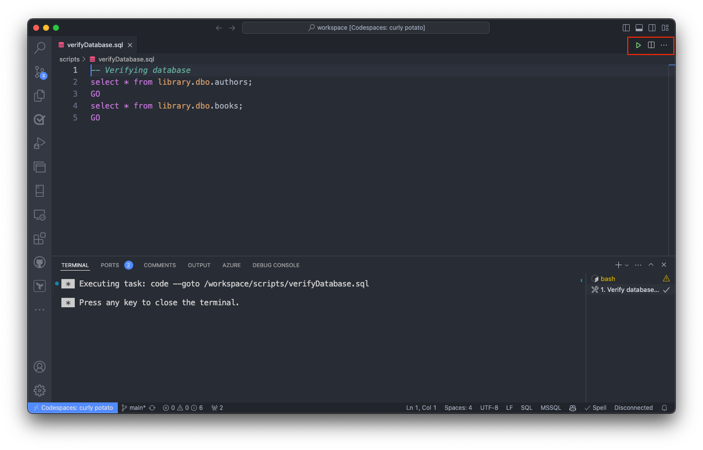
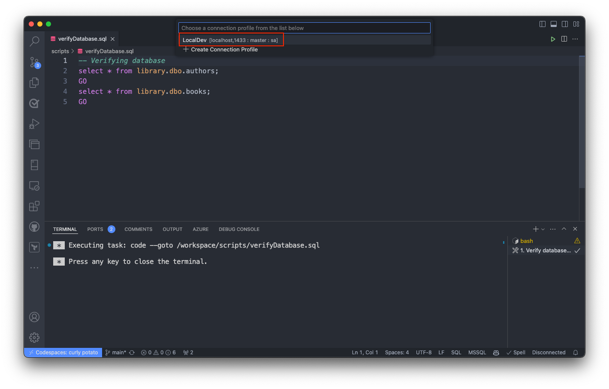
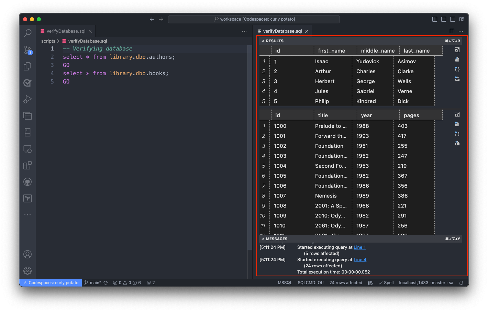
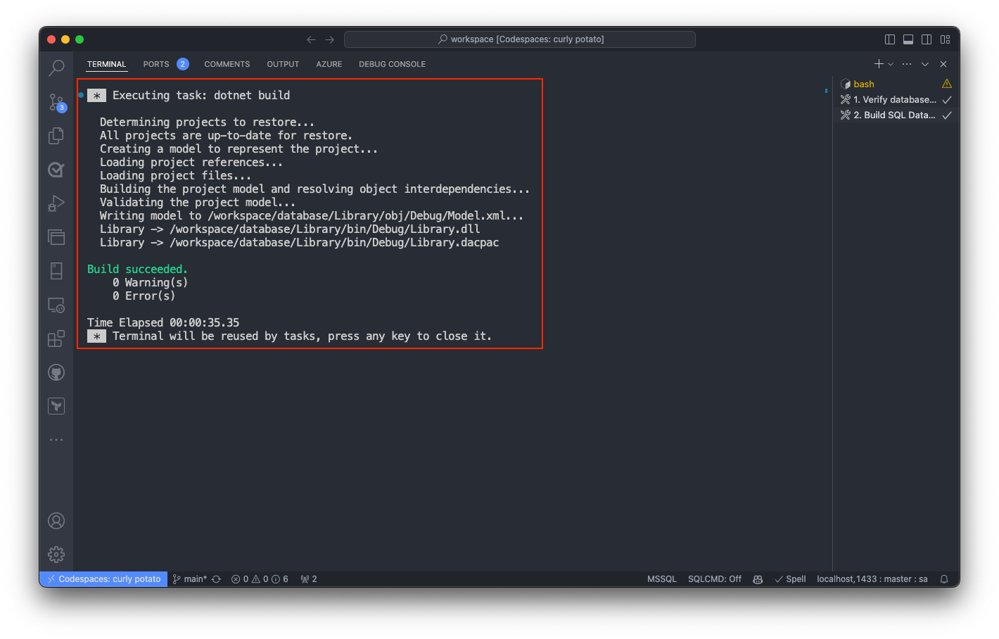
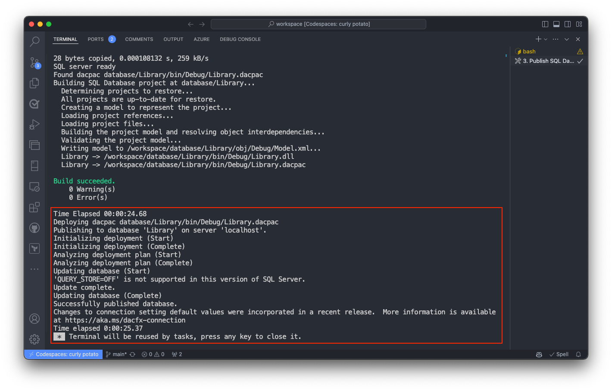

# Node.js and Azure SQL (javascript-node)

A development environment for Node.js and Azure SQL, enabling streamlined local development and testing.

## Options

| Options Id | Description | Type | Default Value |
|-----|-----|-----|-----|
| imageVariant | Node.js version: | string | 24-trixie |


This template sets up a Node.js development environment with a local Azure SQL Database developer container and a sample database. The database schema lives in a SQL Database project that targets Azure SQL Database.

Use it in VS Code with the Dev Containers extension, in GitHub Codespaces, or with the Dev Container CLI.

## What the template creates

Docker Compose runs two containers:

- `app` is the container you work in. It uses `mcr.microsoft.com/devcontainers/javascript-node` on Debian 13 (trixie).
- `db` runs the Azure SQL Database developer container from `mcr.microsoft.com/mssql/azure-sql-db-server:latest`.

The `app` container shares the network of the `db` container. From inside `app`, Azure SQL Database is at `localhost,1433`.

When the container is created, `postCreateCommand` builds the SQL Database project in `database/Library`. Then it provisions `Library` through a `master` connection and publishes the result to `Library` with SqlPackage. Application queries connect directly to `Library`; do not switch databases with `USE`. You start with a `Library` database that already has data in it.

### How Azure SQL Database compatibility works

The local container runs the Azure SQL Database engine. The SQL Database project also targets Azure SQL Database (`SqlAzureV12DatabaseSchemaProvider`), so unsupported schema features fail the project build. The container is for development, testing, and demos, not production.

The preview has known restriction-enforcement gaps and defaults that can differ from the cloud. Test your app against Azure SQL Database in Azure before you ship it. See the [container limitations](https://github.com/microsoft/azure-sql-database-container/blob/main/docs/known-limitations.md). To learn more, see [Target platform](https://learn.microsoft.com/sql/tools/sql-database-projects/concepts/target-platform?view=sql-server-ver17).

## Create the dev container

### VS Code

1. Install Docker and the Dev Containers extension. See [Developing inside a container](https://code.visualstudio.com/docs/devcontainers/containers).
1. Open your project folder in VS Code.
1. Press <kbd>F1</kbd> and run **Dev Containers: Add Dev Container Configuration Files...**.
1. Select **Show All Definitions...**, type **Azure SQL**, and select the `javascript-node` template.
1. Pick the options, then run **Dev Containers: Reopen in Container**.

The first build pulls both images and takes a few minutes.

### GitHub Codespaces

1. Open a codespace on your repository.
1. Press <kbd>F1</kbd> and run **Codespaces: Add Dev Container Configuration Files...**.
1. Select **Show All Definitions...**, type **Azure SQL**, and select the `javascript-node` template.
1. Run **Codespaces: Rebuild Container**.

### Dev Container CLI

```bash
devcontainer templates apply -t ghcr.io/microsoft/azuresql-devcontainers/javascript-node
devcontainer up --workspace-folder .
```

To pick an image variant, pass it as a template argument:

```bash
devcontainer templates apply -t ghcr.io/microsoft/azuresql-devcontainers/javascript-node \
  -a '{"imageVariant":"22-trixie"}'
```

## Image variants

| `imageVariant` | What you get |
|---|---|
| `24-trixie` (default) | Node.js 24 on Debian 13. |
| `22-trixie` | Node.js 22 on Debian 13. |

## Apple Silicon and other Arm64 hosts

Both containers support native `linux/amd64` and `linux/arm64`, including Apple Silicon. Compose selects the host architecture; no amd64 override or Rosetta emulation is needed. Use Linux containers and allocate at least 4 GB of memory and 2 CPUs to the runtime; the database service is limited to 2 GB and 2 CPUs. See the [upstream prerequisites](https://github.com/microsoft/azure-sql-database-container/blob/main/docs/prerequisites.md).

## Tools in the container

- The .NET 10 SDK, from the dotnet Dev Container Feature. The SQL Database project build and SqlPackage need it.
- SqlPackage, installed as a .NET tool and on `PATH`.
- `sqlcmd` from go-sqlcmd v1.10.0.
- Azure CLI with Bicep.
- Azure Developer CLI (`azd`).
- Docker CLI, which talks to the host's Docker engine through the docker-outside-of-docker Feature.

## VS Code extensions

The template installs `ms-mssql.mssql`. Its extension pack adds the SQL Database Projects extension. The template also installs the JavaScript and Node.js extensions. See `.devcontainer/devcontainer.json` for the full list.

The MSSQL extension has a connection profile named **LocalDev**. It connects to the `Library` database at `localhost,1433` as `sa`. Some graphical features of the MSSQL extension are not yet fully compatible with the preview; if a UI feature fails, query with `sqlcmd -S localhost -d Library -U sa -C` instead (set `SQLCMDPASSWORD` from `MSSQL_SA_PASSWORD`).

GitHub Copilot is not in the list. Current VS Code ships GitHub Copilot Chat built in, and asking for `github.copilot` or `github.copilot-chat` makes the extension install fail, because a built-in extension cannot be replaced from the Marketplace. On older VS Code, install GitHub Copilot yourself.

## Connect from Node.js

Add the `mssql` package to your project:

```bash
npm install mssql
```

```javascript
const sql = require('mssql');

async function main() {
  const pool = await sql.connect({
    server: 'localhost',
    port: 1433,
    user: 'sa',
    password: process.env.MSSQL_SA_PASSWORD,
    database: 'Library',
    options: { trustServerCertificate: true },
  });
  const result = await pool.request().query('SELECT COUNT(*) AS books FROM dbo.books');
  console.log(result.recordset[0].books);
  await pool.close();
}

main();
```

`trustServerCertificate: true` skips TLS certificate validation. Use it only against the local container.

## VS Code tasks

To run a task, press <kbd>F1</kbd>, run **Tasks: Run Task**, and pick the task.





If VS Code asks about scanning the task output, select **Continue without scanning the task output**.



### 1. Verify database schema and data

Opens `scripts/verifyDatabase.sql`, which queries the sample tables. Run the script in the MSSQL extension and pick the **LocalDev** connection.







### 2. Build SQL Database project

Runs `dotnet build` in `database/Library`. The output is `database/Library/bin/Debug/Library.dacpac`. If the build fails, check the errors for objects that Azure SQL Database doesn't support.

If this task fails once right after the container is created with `The process cannot access the file '/workspace/database/Library/bin/Debug/Library.dacpac' because it is being used by another process`, the post-create publish was still finishing. Run the task again.



### 3. Publish SQL Database project

Builds the project, provisions `Library` if needed, and publishes to the local Azure SQL Database with SqlPackage, using the `sa` password from `.devcontainer/.env`. Run it after you change the schema. SqlPackage compares the project with the database and applies the changes.



## Sample database

The `Library` database has:

- Tables `dbo.authors`, `dbo.books`, and `dbo.books_authors`.
- View `dbo.vw_books_details`.
- Stored procedure `dbo.stp_get_all_cowritten_books_by_author`.
- Seed data with 5 authors and 24 books.

To change the schema, edit the `.sql` files in `database/Library`, then run tasks 2 and 3.

## Change the sa password

`MSSQL_SA_PASSWORD` in `.devcontainer/.env` sets the `sa` password. Azure SQL Database, the post-create script, and task 3 read it. The **LocalDev** connection profile in `.devcontainer/devcontainer.json` picks it up through `${containerEnv:MSSQL_SA_PASSWORD}`, which the dev container tooling resolves from the container's environment when the container is created. (`${env:...}` does not work here: VS Code writes connection settings as they are, so the profile would arrive with an empty password.)

The default is a development-only password, and it's public in this repository. Change it for anything beyond local development: edit `MSSQL_SA_PASSWORD` in `.devcontainer/.env`, then rebuild the container. That is the only place the password lives; the LocalDev profile follows it. Azure SQL Database requires at least eight characters from three of these four sets: uppercase letters, lowercase letters, digits, and symbols. After you change it, rebuild the container.

## Ports

`forwardPorts` in `.devcontainer/devcontainer.json` forwards ports `3000` and `1433`. Add the ports your app uses there. Use `forwardPorts` instead of `ports` in `docker-compose.yml`, because only `forwardPorts` works in Codespaces.

## Add another service

Add the service to `.devcontainer/docker-compose.yml`. To reach it on `localhost` from the `app` container, put it on the `db` container's network:

```yaml
network_mode: service:db
```

## Troubleshooting: restricted networks

Some corporate networks block the public package registries. The symptom is a container that builds and then fails while it is created, in `onCreateCommand` or `postCreateCommand`, with a connection reset from one of these hosts:

| Host | Used by |
|---|---|
| `api.nuget.org` | SqlPackage, the SQL Database project build, the Aspire CLI |
| `files.pythonhosted.org` | `pip install mssql-python` (python template) |
| `registry.npmjs.org` | `npm install` in your own project (javascript-node template) |

Point the tools at the feeds your organization allows before you rebuild:

- NuGet: add a `NuGet.Config` in the workspace root with your feed.
- pip: set `PIP_INDEX_URL` in `remoteEnv` in `.devcontainer/devcontainer.json`, or add a `pip.conf`.
- npm: `npm config set registry <your registry>`.

If a window is closed or a rebuild is interrupted while the container is still being created, VS Code stops the containers, and later commands report `Error: No such container`. Run **Dev Containers: Rebuild Container**; the templates rebuild from scratch and publish the database again.

## Learn more

- [What are SQL database projects?](https://learn.microsoft.com/sql/tools/sql-database-projects/sql-database-projects?view=sql-server-ver17)
- [SqlPackage Publish](https://learn.microsoft.com/sql/tools/sqlpackage/sqlpackage-publish?view=sql-server-ver17)
- [Azure SQL Database container](https://github.com/microsoft/azure-sql-database-container)
- [Dev Container templates](https://containers.dev/templates)
- [All Azure SQL Database Dev Container templates](https://github.com/microsoft/azuresql-devcontainers)


---

_Note: This file was auto-generated from the [devcontainer-template.json](https://github.com/microsoft/azuresql-devcontainers/blob/main/src/javascript-node/devcontainer-template.json).  Add additional notes to a `NOTES.md`._
